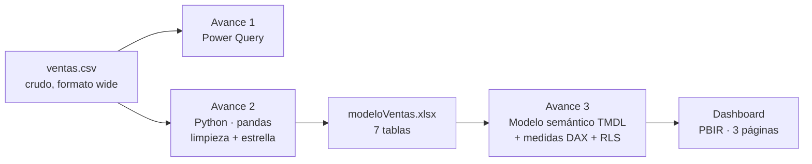
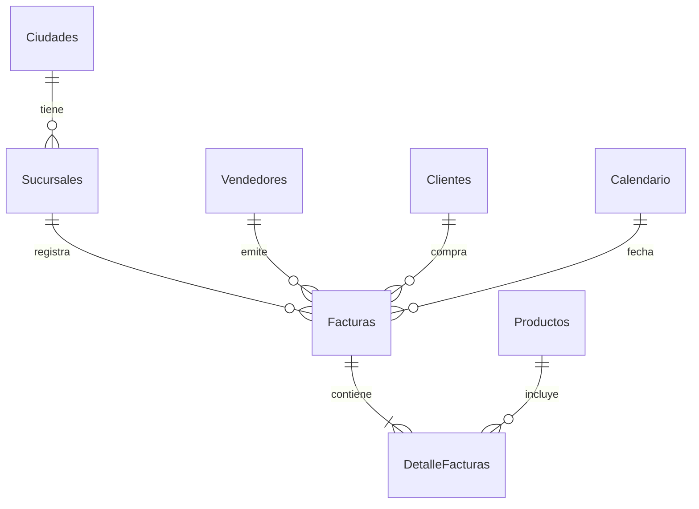

<div align="center">

# TechCore · Análisis de Ventas

**De un CSV sucio a un dashboard ejecutivo con seguridad por rol.**
Power Query · Python · Modelo en estrella · DAX · Power BI (PBIP) · RLS


</div>

---

## Resumen

TechCore es una cadena ficticia de retail tecnológico con **6 sucursales en 4 ciudades de Colombia**.
El proyecto cubre el ciclo completo de BI sobre **30.000 facturas y 60.059 renglones** (sep-2014 → sep-2025):

| Cifra clave | Valor |
|---|---|
| Ventas netas | **$456,5 mil millones** (COP) |
| Ticket promedio | $15,2 millones |
| Clientes únicos | 16.715 (50,5 % recurrentes) |
| Descuento medio otorgado | 2,5 % de las ventas brutas |
| Crecimiento 2025 YTD vs mismo período 2024 | **+1,0 %** |

## Arquitectura



## Modelo en estrella



* **Hechos:** `Facturas` (cabecera, descuento por factura) y `DetalleFacturas` (renglón: cantidad, precio, subtotal y subtotal neto).
* **Dimensiones:** `Productos`, `Clientes` (con rango de edad), `Sucursales`, `Vendedores`, `Ciudades` (con latitud y longitud para el mapa) y `Calendario` (DAX, marcada como tabla de fechas).
* **Medidas** organizadas por carpetas: ventas, volumen, participación e inteligencia de tiempo (YoY, YTD, media móvil 12 M).

## Calidad de datos (lo que se corrigió)

| Problema en el dato crudo | Tratamiento |
|---|---|
| 307 `VentaID` duplicados | Se conserva la primera ocurrencia |
| 20 variantes de marca con typos (`Lenvo`, `HPP`, `Del`, `Aple`, `Azus`, `Samsng`…) | Diccionario → 10 marcas canónicas |
| Ciudades y sucursales con/sin tilde, mayúsculas y nulos | Normalización + inferencia desde el nombre de sucursal |
| Importes y descuentos mal interpretados por la configuración regional (`16000000.0` → `160000000`) | Se parte del CSV crudo y se **valida** `Total = Σ subtotales × (1 − descuento)` en las 30.000 ventas |
| Métodos de pago y descuentos nulos | `No especificado` / `0 %` |

> La validación contable corre como `assert` dentro del notebook: si el dato no cuadra, el modelo no se genera.

> **Nota:** `01_Avance1_Limpieza/ventasTransformed.csv` se conserva como entregable histórico del Avance 1, pero contiene importes ×10 por la configuración regional. El modelo vigente se construye desde `ventas.csv` (ver Avance 2).

## Dashboard

Tema oscuro propio (`techcore.json`), navegación con botones y tres páginas de análisis más dos de apoyo:

| Página | Qué muestra |
|---|---|
| **Resumen** | 6 KPIs (ventas netas, facturas, ticket, clientes, crecimiento anual, % descuento), ventas por año (los años parciales en ámbar), **mapa de Colombia** por ciudad, método de pago, marcas y sucursales |
| **Productos** | Top 8 productos, **posicionamiento de marcas** (volumen vs. precio medio) y detalle por producto con barras de datos |
| **Clientes y equipo** | Matriz ciudad → sucursal, clientes por género y por rango de edad, top 8 vendedores y estacionalidad mensual |
| **Ficha de sucursal** *(oculta, drillthrough)* | KPIs, ventas por año y por marca, top 5 vendedores y medios de pago de una sucursal |
| **Tooltip** *(oculta)* | Mini-resumen que aparece al pasar el mouse por el mapa y los gráficos |

### Interactividad

* Segmentadores de **año** y **ciudad** (o marca en Productos) y botón **Limpiar** para borrar todos los filtros.
* **Drillthrough:** clic derecho sobre una sucursal → *Ficha de sucursal*; el botón *Volver* regresa al informe.
* **Tooltips de página** en mapa, marcas, sucursales, método de pago y productos.
* **Crecimiento anual** comparado de forma justa (último año contra el mismo período del año anterior, así que 2025 parcial no parece una caída) y coloreado en verde o rojo.
* Los gráficos de ranking usan filtros **Top N** (productos, vendedores).

### Seguridad a nivel de fila (RLS)

| Rol | Ve |
|---|---|
| Gerente Nacional | Todo |
| Gerente Regional | Solo su ciudad |
| Gerente Sucursal | Solo su sucursal |

La tabla `UsuariosSeguridad` mapea correo → ciudad/sucursal (usuarios de ejemplo; reemplazar por los reales antes de publicar).

## Estructura del repositorio

```
.
├── 01_Avance1_Limpieza/            # Power Query: ventas.csv + .pbix de limpieza
├── 02_Avance2_ModeloRelacional/    # Notebook (limpieza + estrella) y modeloVentas.xlsx
├── 03_Avance3_Dashboard/
│   ├── TechCore_Dashboard.pbip     # abrir este archivo en Power BI Desktop
│   ├── TechCore.SemanticModel/     # modelo en TMDL (versionable)
│   └── TechCore.Report/            # reporte en PBIR (versionable)
├── 04_Documentacion/               # Conclusiones y recomendaciones
├── assets/
└── requirements.txt
```

## Cómo reproducirlo

```bash
pip install -r requirements.txt
cd 02_Avance2_ModeloRelacional
jupyter nbconvert --to notebook --execute --inplace Avance_2_Modelo_Relacional.ipynb   # regenera modeloVentas.xlsx
```

1. Abrí `03_Avance3_Dashboard/TechCore_Dashboard.pbip` en **Power BI Desktop** (versión reciente).
2. Si movés la carpeta, actualizá el parámetro **`RutaDatos`** (Transformar datos → Parámetros) con la ruta de `02_Avance2_ModeloRelacional\`.
3. Actualizar.

## Hallazgos principales

Detalle completo en [`04_Documentacion/Conclusiones_Recomendaciones.md`](04_Documentacion/Conclusiones_Recomendaciones.md).

* **Concentración geográfica:** Medellín (44,7 %) y Bogotá (30,6 %) suman el 75 % de las ventas.
* **Mix:** Lenovo lidera (25 %), seguido de HP, Dell y Apple; Apple y Razer tienen el precio medio por unidad más alto.
* **Estabilidad:** 2015-2024 se mantiene en una banda de $40-43 mil millones anuales; 2014 y 2025 son años parciales.
* **Pagos:** 60 % con tarjeta; 4,8 % de facturas sin método de pago registrado.

## Autor

**Cristian Atrio** · Proyecto Integrador — Módulo 3
